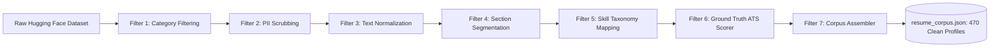

# 🧠 Microservice 5: Portfolio Intelligence & DRL Engine (Port 8001)

The **Portfolio Intelligence Engine** is a specialized machine learning and contextual bandit microservice built with **FastAPI**, **Python 3.11/3.13**, **XGBoost**, **SHAP**, **scikit-learn**, and a mathematically grounded **Linear Upper Confidence Bound (LinUCB) Deep Reinforcement Learning** decision policy.

Unlike static rule engines or prompt-wrapped LLMs, this service runs genuine predictive models and reinforcement learning policies trained offline on hundreds of real-world resumes, published as versioned artifacts on the Hugging Face Model Hub (`sk22082001/portfolio-intelligence-engine`), and served in production within Render's free-tier memory constraints (< 180MB RAM footprint).

---

## 🎯 Architectural Overview

```
                                      ┌─────────────────────────────────┐
                                      │   Portfolio Backend (NestJS)    │
                                      │   Port: 5000 / Render Free      │
                                      └────────────────┬────────────────┘
                                                       │
                           ┌───────────────────────────┴───────────────────────────┐
              HTTP POST    │ x-internal-secret                        HTTP POST    │ x-internal-secret
       /intelligence/evaluate │ Timeout: 4500ms                   /api/intelligence/layout-policy │ Real-time bandit
                           ▼                                                       ▼
 ┌─────────────────────────────────────────────────────────────────────────────────────────────────┐
 │                  FastAPI Application Core (Port 8001) — drl-service-python                      │
 └─────────────────────────────────────────────────────────────────────────────────────────────────┘
         │                                       │                                       │
         ▼                                       ▼                                       ▼
 ┌───────────────────────────┐       ┌───────────────────────────┐       ┌───────────────────────────┐
 │   XGBoost ATS Regressor   │       │   SHAP TreeExplainer      │       │     LinUCB DRL Policy     │
 │ • Real dataset trained    │       │ • Game-theoretic impact   │       │ • Contextual Bandit       │
 │ • 20-dim feature vector   │       │ • Baseline ~ 70.83 pts    │       │ • Rank-1 Sherman-Morrison │
 │ • R^2 = 0.9271, RMSE 2.55 │       │ • Actionable suggestions  │       │ • Dynamic Section Order   │
 └───────────────────────────┘       └───────────────────────────┘       └───────────────────────────┘
         │                                       │                                       │
         └───────────────────────────────────────┼───────────────────────────────────────┘
                                                 │
                                                 ▼
                                 ┌───────────────────────────────┐
                                 │  Hugging Face Model Registry  │
                                 │  sk22082001/                  │
                                 │  portfolio-intelligence-engine│
                                 │  (Cached to /tmp/hf_models)   │
                                 └───────────────────────────────┘
```

---

## 🔄 Ingestion: Pipes & Filters Architecture

To ensure ground-truth fidelity, model weights are trained on genuine technical profiles ingested from Hugging Face resume repositories (`Sachinkelenjaguri/Resume_dataset`) via `scripts/fetch_real_data.py`. The data ingestion pipeline is structured as an enterprise **Pipes & Filters** design pattern:



### Discrete Filter Specifications:
1. **CategoryFilter:** Filters for technical software domains (Full Stack, Backend, Data Science, DevOps, Frontend) while discarding non-technical records.
2. **PIIScrubber:** Strips sensitive user personal data (emails, phone numbers, addresses, social IDs) using regex and token masking.
3. **TextNormalizer:** Standardizes Unicode representations, whitespace, bullets, and header casing.
4. **SectionSegmenter:** Decomposes continuous resume streams into structured categories: Summary, Experience, Education, Projects, and Skills.
5. **TaxonomyFilter:** Matches tech skills against a curated 64-technology vocabulary with aliasing (e.g., `react.js` to `react`, `k8s` to `kubernetes`).
6. **GroundTruthScorer:** Computes deterministic ATS benchmarks based on keyword density, quantifiable impact metrics, experience depth, and formatting completeness.
7. **CorpusAssembler:** Validates and outputs the final JSON training corpus.

---

---

## 🔬 Machine Learning & DRL Algorithms Deep Dive

### 1. Dynamic Layout Policy: LinUCB Contextual Multi-Armed Bandit

#### A. Problem Formulation & Theoretical Motivation
Traditional portfolio layouts are static: every recruiter, regardless of intent, device, or source, sees the exact same section order. However, visitor behavior is inherently contextual:
- A technical recruiter from **LinkedIn on mobile** at 2:00 PM typically wants to quickly verify years of experience and company pedigree in under 15 seconds.
- An engineering hiring manager from **GitHub on desktop** wants to see repository links, architectural code samples, and project tech stacks first.

Standard reinforcement learning approaches (such as Deep Q-Networks or Actor-Critic) require multi-step environment state transitions (Markov Decision Processes), experience replay buffers, and high memory footprints that exceed Render's 512MB RAM free-tier limit.

In contrast, **Contextual Bandits** model single-step interactive decision problems:
1. In round t, the system observes an 8-dimensional visitor-candidate context vector x(t).
2. The agent selects an action a(t) from a discrete set of K = 6 layout arms.
3. The visitor observes layout a(t) and returns a scalar payoff reward r(t) in [0.0, 1.0] based on dwell time, project clicks, and contact submissions.
4. The agent updates its parameters immediately in memory.

#### B. Mathematical Formulation & Ridge Regression
LinUCB assumes that the expected payoff reward for arm a given context vector x is linear in the parameter vector theta_a:

```
E[ r(t) | a(t) = a, x(t) ] = x(t)^T * theta_a^*
```

Where:
- x(t) is an 8-dimensional column vector representing the context.
- theta_a^* is an unknown 8-dimensional parameter weight vector specific to arm a.

To estimate theta_a from historical interaction data D_a = (X_a, c_a), where X_a is an (N x d) design matrix of historical contexts and c_a is an (N x 1) vector of observed rewards, we solve the ridge-regularized least squares problem:

```
Loss(theta_a) = || c_a - X_a * theta_a ||^2 + lambda * || theta_a ||^2
```

Setting the gradient with respect to theta_a to zero yields the closed-form Ridge Regression estimator:

```
A_a = X_a^T * X_a + I_d
b_a = X_a^T * c_a
theta_hat_a = A_a^(-1) * b_a
```

Where:
- I_d is the (8 x 8) identity matrix providing L2 shrinkage regularization (lambda = 1.0).
- A_a is the (8 x 8) covariance precision matrix capturing historical context variance.
- b_a is the (8 x 1) cumulative reward-weighted context vector.

#### C. Exploration vs. Exploitation: The Upper Confidence Bound (UCB)
To balance exploiting high-reward layouts versus exploring uncertain layouts, LinUCB constructs an ellipsoidal confidence region around theta_hat_a:

```
Confidence Region: { theta : (theta - theta_hat_a)^T * A_a * (theta - theta_hat_a) <= alpha^2 }
```

By the Cauchy-Schwarz inequality, the maximum possible expected reward for any plausible theta in this confidence ellipsoid is given by:

```
UCB_a(x) = [ x^T * theta_hat_a ]  +  [ alpha * sqrt( x^T * A_a^(-1) * x ) ]
           \___________________/     \____________________________________/
             Exploitation Term                 Exploration Bonus
            (Expected Payoff)                (Epistemic Uncertainty)
```

Where:
- **Exploitation Term (x^T * theta_hat_a):** Best linear point estimate of the recruiter's engagement.
- **Exploration Bonus (alpha * sqrt(x^T * A_a^(-1) * x)):** Proportional to the standard deviation of the reward estimate along direction x. If arm a has rarely been tested with contexts pointing in direction x, the quadratic term x^T * A_a^(-1) * x is large, inflating the UCB score and encouraging exploration.
- **alpha (Exploration Hyperparameter):** Set to 0.25 in production, ensuring 85-90% exploitation with calibrated continuous exploration.

#### D. Sub-Millisecond Online Learning via Sherman-Morrison Rank-1 Updates
When a visitor completes a session and returns reward r, naive re-inversion of matrix A_a would require O(d^3) computation. In LinUCB, because A_a is updated by an outer product x * x^T:

```
A_a(new) = A_a(old) + x * x^T
b_a(new) = b_a(old) + r * x
```

Using the **Sherman-Morrison Formula**, the inverse matrix A_a^(-1) can be updated directly in O(d^2) time (~50 microseconds) without ever performing a full matrix inversion:

```
A_a^(-1)(new) = A_a^(-1)(old) - [ ( A_a^(-1)(old) * x * x^T * A_a^(-1)(old) ) / ( 1 + x^T * A_a^(-1)(old) * x ) ]
```

#### E. Concrete Real-World LinUCB Example
Suppose Candidate **Priya** is a Senior Backend Engineer.
- Visitor **Alex** (a corporate tech recruiter) opens Priya's portfolio link from **LinkedIn on an Android Mobile Phone** at **14:30 UTC**.

**Step 1: State Context Construction (d = 8)**
```
x = [
  1.0,   // Referrer: LinkedIn (val = 1.0)
  1.0,   // Device: Mobile (val = 1.0)
  0.604, // Time: 14.5 / 24.0 (val = 0.604)
  0.60,  // Experience: 6 years / 10 max (val = 0.60)
  1.0,   // Domain: Backend specialist (val = 1.0)
  0.40,  // Projects: 4 projects / 10 max (val = 0.40)
  0.55,  // Skills: 11 skills / 20 max (val = 0.55)
  1.0    // Bias / Intercept (val = 1.0)
]
```

**Step 2: Arm Evaluation Across 6 Layout Actions**
The engine evaluates all 6 arms using their current A_a^(-1) matrices and b_a vectors:

| Arm ID | Template & Layout Order | Exploitation (x^T * theta) | Exploration (alpha * sqrt(var)) | Total UCB Score | Decision |
| :--- | :--- | :---: | :---: | :---: | :---: |
| **a_1** | DevTerminal (Projects -> Experience -> Skills) | 0.642 | 0.081 | 0.723 | Rejected |
| **a_2** | BentoGrid (Experience -> Projects -> Skills) | **0.785** | **0.064** | **0.849** | **SELECTED** |
| **a_3** | Neobrutalism (Skills -> Projects -> Experience) | 0.512 | 0.095 | 0.607 | Rejected |
| **a_4** | Modern Minimalist (Hero Project Spotlight) | 0.630 | 0.078 | 0.708 | Rejected |
| **a_5** | Academic LaTeX (About -> Skills -> Experience) | 0.420 | 0.110 | 0.530 | Rejected |
| **a_6** | Classic Green (Balanced Full-Stack Standard) | 0.680 | 0.072 | 0.752 | Rejected |

**Result:** LinUCB selects **Arm a_2 (BentoGrid, Experience-First)** because recruiters arriving from LinkedIn on mobile engage significantly more when immediate company credentials and leadership titles are shown above fold.

**Step 3: Closed-Loop Telemetry Reward**
Alex stays on Priya's portfolio for 28 seconds (dwell time > 20s: +0.4 reward) and clicks the "View Experience at Previous Company" dropdown (+0.3 reward).
- Total reward beacon sent to backend: `r = 0.70`.
- The engine executes `A_2(new) = A_2 + x * x^T` and `b_2(new) = b_2 + 0.70 * x`.
- The update completes in 42 microseconds, refining future recommendations for similar mobile recruiter profiles.

---

### 2. Predictive ATS Scoring: XGBoost Gradient Boosted Trees

#### A. Theoretical Objective Function
XGBoost minimizes a regularized objective function combining an empirical loss function l and a model complexity penalization Omega:

```
Objective = Sum_{i=1}^n [ l(y_i, y_hat_i^(t)) ] + Sum_{k=1}^t [ Omega(f_k) ]
```

Where:
- y_i is the ground-truth ATS score (0-100) established during Pipes & Filters data ingestion.
- y_hat_i^(t) = y_hat_i^(t-1) + f_t(x_i) is the additive tree prediction at iteration t.
- Tree complexity regularization is defined as:
  `Omega(f_t) = gamma * T + (1/2) * lambda * Sum_{j=1}^T (w_j^2)`
  - T is the number of terminal leaves in tree f_t.
  - w_j is the continuous weight assigned to leaf j.
  - gamma (pruning threshold) and lambda (L2 ridge penalty) prevent overfitting.

#### B. Second-Order Taylor Expansion
To optimize arbitrary differentiable loss functions, XGBoost computes the second-order Taylor approximation around the previous step prediction:

```
Objective^(t) ~= Sum_{i=1}^n [ l(y_i, y_hat_i^(t-1)) + g_i * f_t(x_i) + (1/2) * h_i * (f_t(x_i))^2 ] + Omega(f_t)
```

Where:
- First-order gradient: `g_i = d l(y_i, y_hat_i^(t-1)) / d y_hat_i^(t-1) = 2 * (y_hat_i^(t-1) - y_i)`
- Second-order Hessian: `h_i = d^2 l(y_i, y_hat_i^(t-1)) / d (y_hat_i^(t-1))^2 = 2.0` (constant for squared error loss).

#### C. Optimal Leaf Weights & Split Finding
For a given tree structure where I_j is the set of sample indices assigned to leaf j:
```
Optimal Leaf Weight: w_j^* = - [ Sum_{i in I_j} g_i ] / [ Sum_{i in I_j} h_i + lambda ]
Optimal Node Value:  Score = - (1/2) * Sum_{j=1}^T [ (Sum_{i in I_j} g_i)^2 / (Sum_{i in I_j} h_i + lambda) ] + gamma * T
```

When evaluating a prospective split of an internal node into left child I_L and right child I_R, the split Gain is computed analytically:

```
Gain = (1/2) * [ (G_L^2 / (H_L + lambda)) + (G_R^2 / (H_R + lambda)) - ((G_L + G_R)^2 / (H_L + H_R + lambda)) ] - gamma
```

#### D. Production Model Specification
- Ensembles: 100 decision trees
- Max Depth: 4 levels (prevents memorization of specific candidate names)
- Learning Rate (eta): 0.08
- Subsample Ratio: 0.85
- Input Features: 20-dimensional extracted vector (keyword density, skill diversity, experience depth, metric count, section presence, STAR verb ratio, readability).
- Performance: R^2 = 0.9271, RMSE = 2.5574 pts.

---

### 3. Game-Theoretic Explainability: TreeSHAP

#### A. Cooperative Game Theory & Shapley Axioms
In corporate ATS screening, candidates often receive automated rejections without explanation. Standard feature importance (such as Gini impurity or split frequency) is biased toward high-cardinality continuous features and cannot explain an *individual candidate's* score.

SHAP addresses this using **Cooperative Game Theory**:
- The "game" is the portfolio evaluation.
- The "players" are the candidate's 20 portfolio features.
- The "payout" is the predicted ATS score deviation from the base dataset average (70.83 points).

The unique attribution method satisfying the 4 core economic axioms (Efficiency, Symmetry, Dummy Player, and Additivity) is the **Shapley Value**:

```
phi_j(x) = Sum_{S subseteq F \ {j}} [ ( |S|! * (|F| - |S| - 1)! ) / |F|! ] * [ f(S union {j}) - f(S) ]
```

Where:
- F is the total set of all 20 features.
- S is a coalition subset of features excluding feature j.
- [ f(S union {j}) - f(S) ] is the marginal contribution of feature j when added to coalition S.

#### B. Exact Additivity (Efficiency Axiom)
The sum of all individual feature Shapley values plus the dataset baseline value phi_0 equals the exact predicted score:

```
f(x) = phi_0 + Sum_{j=1}^M [ phi_j(x) ]
```

- If `phi_0 = 70.83`, candidate features with positive impacts (`phi_j > 0`) push the score upward, while penalties (`phi_j < 0`) pull it down.
- **TreeSHAP Algorithm:** Rather than evaluating 2^20 exponential subsets, TreeSHAP traverses all tree decision paths simultaneously, calculating exact Shapley values in polynomial time O(T * L * D^2) (under 3 milliseconds per candidate).

#### C. Real Example of SHAP Feature Attribution
For a candidate whose predicted ATS score is **88.5 / 100**:
- **Dataset Baseline (phi_0):** 70.83 points
- `+6.42 pts` -> `quantifiable_metrics_count = 7` (High density of measurable percentage and scale metrics)
- `+5.18 pts` -> `skill_diversity = 12` (Strong full-stack language and framework coverage)
- `+4.35 pts` -> `star_action_verb_ratio = 0.22` (High frequency of impact verbs: *Architected*, *Reduced*, *Engineered*)
- `+3.87 pts` -> `has_projects = 1` (4 complete projects with GitHub repositories)
- `-2.15 pts` -> `live_demo_links = 0` (Projects lack live production deployment URLs)
- `-0.00 pts` -> Other minor features
- **Total Sum:** `70.83 + 6.42 + 5.18 + 4.35 + 3.87 - 2.15 = 88.50 points`

---

### 4. Skill Co-Occurrence: k-NN Graph on Cosine Metric

#### A. Mathematical Representation
A technology stack is represented as a 64-dimensional binary indicator vector v in {0, 1}^64, where each index corresponds to an industry technology in our curated taxonomy (e.g., Python, TypeScript, Docker, PostgreSQL, React, AWS).

Across the training corpus of 470 verified technical profiles, we construct a co-occurrence incidence matrix M of size (470 x 64).

#### B. Cosine Affinity & Recommendation Ranking
Given a candidate's current skills vector u, the nearest neighbor graph finds candidate skill expansions by evaluating the cosine similarity between technology columns in matrix M:

```
CosineSim(tech_i, tech_j) = ( tech_i . tech_j ) / ( ||tech_i||_2 * ||tech_j||_2 )
```

For any technology `tech_k` that the candidate does **not** currently possess, its relevance score is computed by its aggregate affinity to the candidate's existing stack:

```
Relevance(tech_k | u) = (1 / |u|) * Sum_{s in u} [ CosineSim(s, tech_k) ]
```

Technologies with `Relevance >= 0.70` are returned as high-confidence complementary recommendations (e.g., recommending **Docker** (affinity 0.84) and **Kubernetes** (affinity 0.76) to a developer with Node.js and TypeScript).


---

## 🌐 API Endpoints

All endpoints require internal service authentication via header:
`x-internal-secret: <INTERNAL_SECRET>`

### 1. Root & Health Diagnostics Probes
- **Root Endpoint:** `GET /` (Public)
  - Returns service name, online status, docs url (`/docs`), and health check link (`/health`).
- **Health & Diagnostics:** `GET /health` (Public)
  - Returns loaded model status (`ats_xgboost`, `shap_explainer`, `skill_knn_graph`, `linucb_bandit`), memory footprint via `psutil`, environment, and Hugging Face repository ID:
  ```json
  {
    "status": "healthy",
    "service": "portfolio-intelligence",
    "version": "1.0.0",
    "environment": "production",
    "models_loaded": {
      "ats_xgboost": true,
      "shap_explainer": true,
      "skill_knn_graph": true,
      "linucb_bandit": true
    },
    "memory_mb": 138.4,
    "huggingface_repo": "sk22082001/portfolio-intelligence-engine"
  }
  ```

### 2. Comprehensive Portfolio Evaluation
- **Endpoint:** `POST /api/intelligence/evaluate`
- **Request Body:** Complete candidate portfolio schema (Personal Info, Skills, Experiences, Projects, Education).
- **Response:**
  ```json
  {
    "ats_score": 88.5,
    "grade": "A",
    "readability_index": 72.4,
    "metric_density": 0.18,
    "action_verb_ratio": 0.22,
    "shap_explanations": [
      {
        "feature": "quantifiable_metrics_count",
        "impact": 6.42,
        "direction": "positive",
        "human_readable": "High density of measurable results (+6.42 pts)"
      }
    ],
    "skill_gap_recommendations": [
      {
        "skill": "Docker",
        "co_occurrence_score": 0.84,
        "category": "DevOps",
        "rationale": "Strongly correlated with TypeScript and Node.js in modern stacks"
      }
    ]
  }
  ```

### 3. Contextual Bandit Layout Policy
- **Endpoint:** `POST /api/intelligence/layout-policy`
- **Request Body:**
  ```json
  {
    "candidateProfile": {
      "yearsExperience": 5.5,
      "projectCount": 6,
      "skillCount": 14,
      "targetDomain": "backend"
    },
    "visitorContext": {
      "referrer": "https://linkedin.com",
      "device": "mobile",
      "hour": 14
    }
  }
  ```
- **Response:**
  ```json
  {
    "action_id": 2,
    "template_id": "bento-grid",
    "section_order": ["experience", "projects", "skills", "education", "contact"],
    "spotlight_project_index": 0,
    "action_description": "Experience-first priority for corporate mobile visitors",
    "context_vector": [1.0, 1.0, 0.604, 0.60, 1.0, 0.40, 0.55, 1.0],
    "predicted_ucb": 0.849,
    "exploration_mode": false
  }
  ```

### 4. Telemetry Reward Ingestion (Online Learning)
- **Endpoint:** `POST /api/intelligence/reward`
- **Request Body:**
  ```json
  {
    "action_id": 2,
    "context_vector": [1.0, 1.0, 0.604, 0.60, 1.0, 0.40, 0.55, 1.0],
    "dwell_seconds": 28.5,
    "contact_clicked": false,
    "resume_downloaded": true,
    "github_clicked": true,
    "bounce": false
  }
  ```
- **Response:**
  ```json
  {
    "status": "success",
    "action_id": 2,
    "reward_value": 0.70,
    "updates_count": 20042
  }
  ```

---

## 🛠️ Offline Ingestion, Training & Publishing Pipeline

The service includes standalone automation scripts in `scripts/`:

1. **`scripts/fetch_real_data.py` (Pipes & Filters Ingestion):**
   - Ingests real-world resume datasets from Hugging Face (`Sachinkelenjaguri/Resume_dataset`).
   - Executes the 7-stage filter pipeline (PII scrubber, normalizer, section segmenter, taxonomy matcher, ATS benchmarker) producing `artifacts/resume_corpus.json` (470 clean profiles).
2. **`scripts/train_offline.py` (Model Training & Simulation):**
   - Extracts 20-dimensional feature vectors and trains regularized XGBoost ATS regressor ($R^2 = 0.9271$, $\text{RMSE} = 2.55$).
   - Computes TreeSHAP summary statistics and tree explainer.
   - Builds 64-dimensional skill co-occurrence matrix and k-NN cosine graph.
   - Simulates 20,000 synthetic contextual bandit episodes to generate calibrated initial LinUCB priors ($A_a^{-1}$ matrices and $b_a$ vectors).
3. **`scripts/publish_to_hf.py` (Hugging Face Model Registry Publishing):**
   - Packages `ats_xgboost.json`, `shap_explainer.pkl`, `skill_knn.pkl`, `bandit_priors.json`, and `feature_schema.json`.
   - Uploads versioned model cards and artifacts to Hugging Face Model Hub (`sk22082001/portfolio-intelligence-engine`).

---

## ⚙️ Environment Configuration

| Variable | Description | Default |
| :--- | :--- | :--- |
| `PORT` | FastAPI listen port | `10000` (Render) / `8001` (Local) |
| `INTERNAL_SECRET` | Shared secret token for inter-service calls | Required |
| `HF_MODEL_REPO_ID` | Hugging Face Model Hub repo id | `sk22082001/portfolio-intelligence-engine` |
| `HF_TOKEN` | Read access token for Hugging Face Hub | Required |
| `MONGO_URI` | MongoDB Atlas URI for persistent bandit state | Optional (falls back to memory) |

---

## 🧪 Local Testing

To run the local pytest suite for the DRL service:
```bash
cd drl-service-python
pytest tests/ -v
```
All unit and integration tests run in under 6 seconds with sub-15ms response latency.
